<!--
  ┌──────────────────────────────────────────────────────┐
  │  you opened the raw file. recon instinct: confirmed. │
  │  most visitors only ever see the rendered page.      │
  │  secret phrase for Mini-game 6:  "raw is law"        │
  │                                        — Ameya343    │
  └──────────────────────────────────────────────────────┘
-->

<div align="center">



<a href="#-player-card"></a> <a href="#-arsenal"></a> <a href="#-loadout"></a><br><a href="#-quest-log"></a> <a href="#-mini-games"></a> <a href="#-contact"></a>

<a href="https://www.linkedin.com/in/ameya-ingole-996866315/"></a> <a href="#-contact"></a>

<sub><b>choose your path</b> &nbsp;·&nbsp; recruiter → <a href="#-player-card">TL;DR</a> &nbsp;·&nbsp; engineer → <a href="#-arsenal">arsenal</a> &nbsp;·&nbsp; CTF player → <a href="#-mini-games">mini-games</a></sub>

</div>

```yaml
# ~/.profile  ·  Ameya343
name:       Ameya Ingole
alias:      Ameya343
education:  B.Tech CSE · 3rd year @ Ramdeobaba University (RBU), Nagpur
seeking:    cybersecurity internship or entry-level role
focus:      [web security (OWASP Top 10), network recon, SOC & threat hunting, linux]
toolbox:    [nmap, metasploit, elastic siem, kql, sysmon, powershell, bash, python]
training:   HTB Academy · Junior Cybersecurity Analyst (CJCA) path ✔ 20/20 modules · 20+ HTB labs
ctf:        kBxAc CTF 2026 → rank 65
motto:      build security tools → break them → harden them
```


## 🎮 Player card



> [!TIP]
> **Recruiter TL;DR:** 3rd-year B.Tech CSE student at Ramdeobaba University, looking for a **cybersecurity internship or entry-level role**.
> - **Completed HTB Academy's Junior Cybersecurity Analyst (CJCA) job-role path**: 20 modules across offense (Nmap, footprinting, Metasploit, WordPress) and defense (traffic analysis, incident handling, Elastic SIEM, KQL, Sysmon, threat hunting)
> - **Solved 20+ Hack The Box labs** and **placed #65 in kBxAc CTF 2026**, my first CTF
> - **Built 4 security tools**: a multi-threaded port scanner, an AES-256-GCM password toolkit, an anti-reverse-engineering hardener and a phishing-link detector with a browser extension
>
> **→ [Connect on LinkedIn](https://www.linkedin.com/in/ameya-ingole-996866315/)**


## ⚒ Arsenal

<div align="center">
<a href="https://github.com/Ameya343/Port-Scanner"></a>
<a href="https://github.com/Ameya343/Locksmith"></a>
<a href="https://github.com/Ameya343/Anti-REA"></a>
<a href="https://github.com/Ameya343/homograph-guard"></a>
</div>

<sub>▸ click a card to open the repo · expand a tool below to inspect it</sub>

<details>
<summary><b>◎ Port-Scanner</b> · inspect</summary>
<br>

A fast, multi-threaded TCP/UDP port scanner built to learn socket programming, TCP/IP and recon from the ground up.

- **Multi-threaded** worker pool (100 threads by default, configurable)
- **TCP connect scan + UDP probes**
- **`-sV` version detection**: protocol-aware probes for 14 services (SSH, FTP, SMTP, HTTP/S, MySQL, PostgreSQL, Redis, Memcached, Elasticsearch, VNC, RDP, SMB, MongoDB)
- **Banner grabbing** and **TTL-based OS fingerprinting**
- Flexible ports (`22,80,443` · `1-1024` · `80,100-200`) with **CSV/JSON export**
- Pure standard library, no `pip install` needed

```bash
git clone https://github.com/Ameya343/Port-Scanner && cd Port-Scanner
python port-scanner/port_scanner.py -t 127.0.0.1 -p 1-1024 -sV --os --json results.json
```
</details>

<details>
<summary><b>🔐 Locksmith</b> · inspect</summary>
<br>

A command-line password toolkit that does the crypto properly.

- **Strength checker**: 6 criteria plus entropy (`length × log₂(pool)`)
- **Generator**: Python `secrets`, guarantees every selected character class
- **AES-256-GCM** encryption: authenticated, so tampering is detected
- Key derived with **PBKDF2-HMAC-SHA256 × 260,000**, and a fresh random **salt + IV on every call**
- Self-contained token: `aes:<salt>:<iv>:<ciphertext>`

```bash
pip install cryptography
python src/Locksmith.py
```
</details>

<details>
<summary><b>🛡 Anti-REA</b> · inspect</summary>
<br>

A threat-informed toolkit for hardening **your own** apps against reverse engineering, including the AI-assisted kind. It measures what shipped code leaks (strings, comments, identifiers, endpoints, IPC channels, source maps), strips what it safely can, and generates hardening configs for the rest.

- Stack-agnostic `detect`: web, Electron, Android, iOS, native (C/C++/Rust/Go), Python
- **Tested against a real AI-assisted RE tool.** On the hardened build it recovered **0** of the IPC channels, endpoints and gating identifiers it found in the original, and its unresolved nodes rose from **86 to 700 (8×)**
- Non-destructive, semantics-preserving. Secrets are **flagged to move server-side and rotate**, never auto-edited
- Optional **Rust core**: about 4–5× faster scans, with tests that check byte-for-byte identical results
- Also ships as an **AI-agent skill** · CI resistance gate

```bash
pip install -e .
antirea detect ./my-app && antirea scan ./my-app
antirea harden ./my-app ./my-app-hardened --rename
```
</details>

<details>
<summary><b>⚠ homograph-guard</b> · inspect</summary>
<br>

Catches IDN homograph and phishing links (look-alike Unicode characters, brand imitation, short links, links rewritten by mail gateways) without ever opening the suspect link.

- **CLI, desktop app, Windows installer** and a **browser extension** (Chrome, Edge, Brave, Firefox)
- Parses links like a browser: **WHATWG host rules**, **UTS #46 → punycode**, **Unicode TR39 confusables**
- About 200 global and Indian brands, matched with skeletons at three strengths
- On-device threat DB of **about 264,000** phishing/malware domains, updated daily
- Unwraps a dozen-plus link rewriters (Safe Links, Proofpoint, Mimecast…) and expands short links **without visiting the destination**
- DNS-over-HTTPS to **pinned** Google/Cloudflare/AdGuard resolvers, compared with the real brand from 10 regions

```bash
pip install "git+https://github.com/Ameya343/homograph-guard.git"
homograph-guard "https://pаypal.com/login"     # that "а" is Cyrillic
```
</details>


## 🧰 Loadout

The tools and techniques I've trained on, and where I learned or used each one.

| area | tools & techniques | learned · used in |
|:--|:--|:--|
| **Recon & enumeration** | Nmap · footprinting · banner grabbing | CJCA path · my [Port-Scanner](https://github.com/Ameya343/Port-Scanner) |
| **Exploitation** | Metasploit Framework · WordPress security testing | CJCA path |
| **Web security** | HTTP & web requests · web application basics · OWASP Top 10 | CJCA path · HTB labs |
| **Detection & response** | Elastic Stack (SIEM) · KQL · Sysmon · Windows Event Logs (Get-WinEvent, ETW) · MITRE ATT&CK | CJCA path |
| **Process** | penetration-testing methodology · incident handling · threat hunting | CJCA path |
| **Systems & scripting** | Linux · Bash · Windows · PowerShell & Command Prompt · Python | CJCA path · HTB labs · all 4 of my tools |
| **Networking** | TCP/IP · network traffic analysis · DNS & DNS-over-HTTPS | CJCA path · Port-Scanner · [homograph-guard](https://github.com/Ameya343/homograph-guard) |
| **Security engineering** | AES-GCM & PBKDF2 · anti-reverse-engineering · IDN / punycode | [Locksmith](https://github.com/Ameya343/Locksmith) · [Anti-REA](https://github.com/Ameya343/Anti-REA) · homograph-guard |


## 📜 Quest log

| when | quest | loot |
|:--|:--|:--|
| `2026-06` | Shipped **[Port-Scanner](https://github.com/Ameya343/Port-Scanner)** | multi-threaded TCP/UDP recon from raw sockets |
| `2026-06` | Shipped **[Locksmith](https://github.com/Ameya343/Locksmith)** | AES-256-GCM + PBKDF2, done right |
| `2026-10-10` | Played **kBxAc CTF 2026** | 🏆 **rank #65** in my first CTF |
| `2026-11-08` | Released **[Anti-REA v0.1.0](https://github.com/Ameya343/Anti-REA)** | real RE tool recovered **0** IPC channels/endpoints |
| `2026-11-26` | Released **[homograph-guard v1.3.0](https://github.com/Ameya343/homograph-guard)** | CLI + desktop + installer + browser extension |
| `done` | Completed **HTB Academy Junior Cybersecurity Analyst (CJCA) path** ✔ | 20/20 modules, red + blue team · **20+ HTB labs** |

**Active quests**
- [x] Complete HTB Academy's Junior Cybersecurity Analyst (CJCA) path
- [ ] Land a cybersecurity internship → [let's talk](#-contact)
- [ ] Play the next CTF and beat rank #65
- [ ] Ship the next tool in the arsenal


## 🕹 Mini-games

GitHub won't run JavaScript here, so these run on **your** brain. Open a level, make your call, then open the answer. Keep score.

<details>
<summary><b>LEVEL 1 · 🎣 Spot the real PayPal</b> &nbsp;<sub>phishing · easy?</sub></summary>
<br>

Exactly **one** of these is the real PayPal. Which one?

| | domain |
|:-:|:--|
| **A** | `pаypal.com` |
| **B** | `paypal.com` |
| **C** | `paypa1.com` |
| **D** | `paypal.com.account-verify.info` |

<details>
<summary>🔓 reveal answer</summary>
<br>

**B.**
- **A** looks identical, but its second letter is **Cyrillic `а` (U+0430)**. The name DNS actually resolves is `xn--pypal-4ve.com`. Your eyes can't catch this; [homograph-guard](https://github.com/Ameya343/homograph-guard) can.
- **C** swaps `l` for the digit `1`.
- **D** is a subdomain trick: the site you'd really visit is `account-verify.info`.

</details>
</details>

<details>
<summary><b>LEVEL 2 · 🧭 Where does this link go?</b> &nbsp;<sub>URL parsing</sub></summary>
<br>

```text
https://www.google.com@evil.example/login
```

Does it open Google?

<details>
<summary>🔓 reveal answer</summary>
<br>

**No. It opens `evil.example`.** Everything before `@` in the authority is *userinfo* (an old `user:password@host` syntax), and browsers ignore it when choosing the host. Phishers put a trusted name there because humans read left to right.

</details>
</details>

<details>
<summary><b>LEVEL 3 · 🍎 Is this Apple?</b> &nbsp;<sub>homographs · hard</sub></summary>
<br>

```text
аррӏе.com
```

<details>
<summary>🔓 reveal answer</summary>
<br>

**No.** All five letters are **Cyrillic**: `а р р ӏ е`. Because no Latin letter is mixed in, a simple "mixed-script" check doesn't fire. The DNS name is `xn--80ak6aa92e.com`. This is the *whole-script* homograph case that homograph-guard flags as `HG_WHOLE_SCRIPT`.

</details>
</details>

<details>
<summary><b>LEVEL 4 · 🔐 Which password is stronger?</b> &nbsp;<sub>crypto</sub></summary>
<br>

Using Locksmith's formula, `entropy = length × log₂(pool size)`:

| | password |
|:-:|:--|
| **A** | `P@ssw0rd!` |
| **B** | `correct horse battery staple` |

<details>
<summary>🔓 reveal answer</summary>
<br>

**B.** A is 9 characters from a pool of 94, so **59.0 bits**. B is 28 characters from a pool of 58 (lowercase plus the space as a symbol), so **164.0 bits**.

The catch: the formula assumes random characters, and real attackers start with wordlists. `P@ssw0rd!` is in every one of them, so its real strength is close to zero. Length beats complexity, and a generator beats both.

</details>
</details>

<details>
<summary><b>LEVEL 5 · 🧩 Decode the transmission</b> &nbsp;<sub>encoding</sub></summary>
<br>

```text
QW1leWEzNDMgd2FzIGhlcmU=
```

<sub>hint: the `=` at the end is a giveaway.</sub>

<details>
<summary>🔓 reveal answer</summary>
<br>

It's **Base64**: `echo QW1leWEzNDMgd2FzIGhlcmU= | base64 -d` gives **`Ameya343 was here`**.

Base64 is an *encoding*, not encryption. Anyone can reverse it, so never use it to protect anything.

</details>
</details>

<details>
<summary><b>LEVEL 6 · 🕵 The hidden level</b> &nbsp;<sub>recon</sub></summary>
<br>

This README contains a **secret phrase** that is not visible anywhere on this page. Find it.

<details>
<summary>🔓 reveal hint</summary>
<br>

Rendered Markdown hides some things. Open the README file in the repo and look at the **raw** source, right at the top.

</details>
</details>

<sub><b>score:</b> 6/6 → you think like an analyst · 4–5 → solid instincts · 0–3 → read the answers, you'll never forget them</sub>


<div align="center">

<picture>
  <source media="(prefers-color-scheme: dark)" srcset="https://raw.githubusercontent.com/Ameya343/Ameya343/output/github-snake-dark.svg">
  
</picture>

</div>

## 📡 Contact

<div align="center">

**I'm looking for a cybersecurity internship or entry-level role.**<br>
The fastest way to reach me is LinkedIn.

<a href="https://www.linkedin.com/in/ameya-ingole-996866315/"></a> <a href="https://github.com/Ameya343"></a>

<sub><code>ameya343@rbu:~$ exit</code> · thanks for stopping by</sub>

</div>
